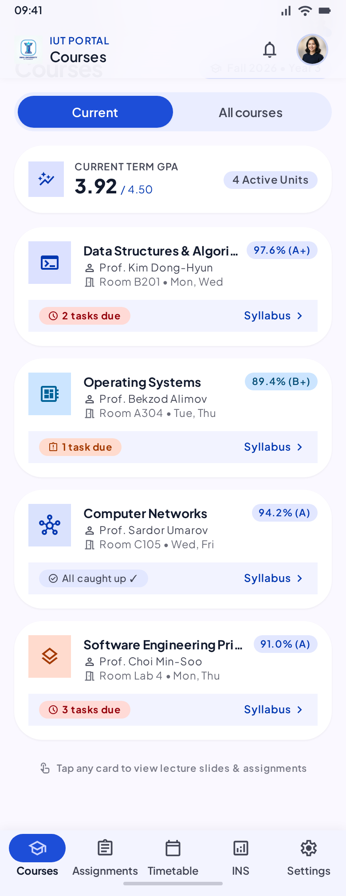
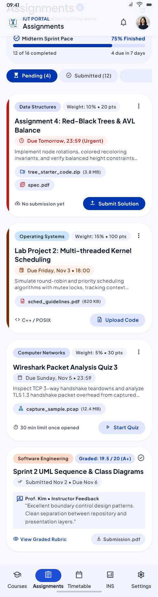
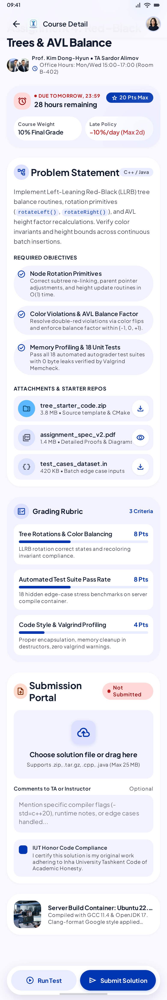
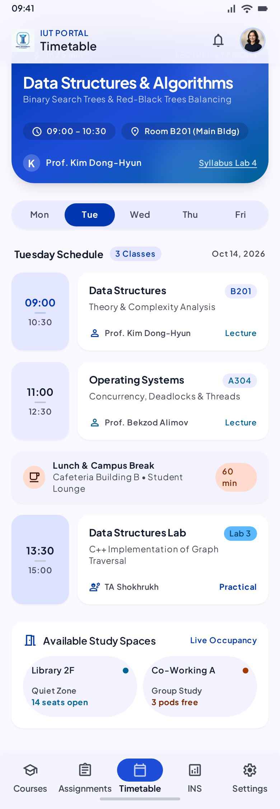
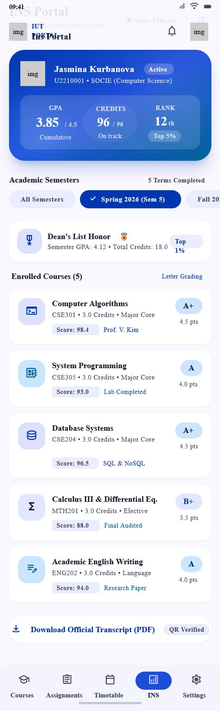
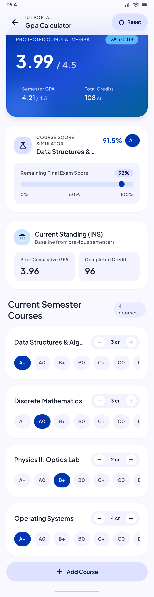
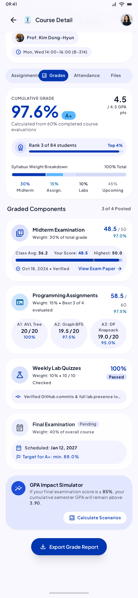
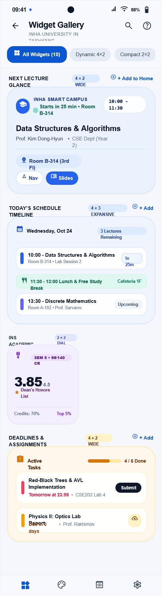
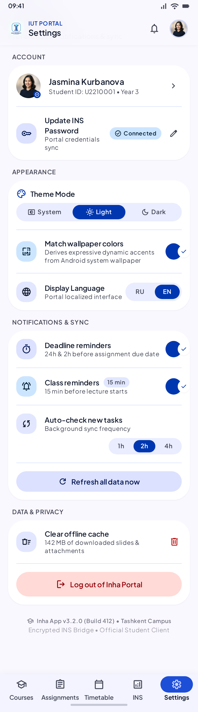

<div align="center">


# Inha App

**Нативный мобильный клиент для студентов Inha University in Tashkent (IUT)**  
`eClass` • `INS Portal` • `EduPage Timetable` • `Material 3 Expressive` • `Offline-First SQLite`

[](https://github.com/crewles/inha-app/releases)
[](https://flutter.dev)
[-3DDC84?style=for-the-badge&logo=android&logoColor=white)](https://github.com/crewles/inha-app/releases/latest)
[](LICENSE)

</div>

---

## О проекте

**Inha App** объединяет три главных студенческих сервиса **Inha University in Tashkent** в одном быстром Android-приложении в стиле **Material 3 Expressive (Dynamic Color / Material You)**. Все данные кэшируются локально на устройстве в **SQLite**, а подключения к серверам университета выполняются напрямую с телефона — без сторонних прокси и промежуточных бэкендов.

---

## Скриншоты интерфейса

### Главные разделы

| Курсы (`eClass`) | Задания и дедлайны | Детали и сдача задания |
| :---: | :---: | :---: |
|  |  |  |

| Расписание (`EduPage`) | Портал `INS` и транскрипт | Калькулятор GPA (шкала 4.5) |
| :---: | :---: | :---: |
|  |  |  |

| Оценки и веса из силлабуса | Виджеты рабочего стола Android | Настройки и диагностика |
| :---: | :---: | :---: |
|  |  |  |

---

## Основные возможности

### 1. `eClass` (`eclass.inha.ac.kr`)
- **Быстрый гибридный клиент**: Moodle Mobile JSON API (`core_enrol_get_users_courses`, `mod_assign_get_assignments`, `mod_assign_get_submission_status`, `core_course_get_contents`, `gradereport_overview_get_course_grades`, `webservice/upload.php`) + веб-фолбэк для посещаемости (`local/ubattendance`) и детализированных таблиц оценок.
- **Сдача работ с телефона**: загрузка и отправка файлов в задания напрямую из приложения с сохранением ранее прикреплённых файлов и просмотром комментариев преподавателя.
- **Файлы и материалы курса**: скачивание материалов (`ubfile`) и вложений заданий в один тап с локальным офлайн-кэшем.
- **Автопарсинг силлабуса**: извлечение процентной разбивки оценок (*Midterm*, *Final*, *Quizzes*, *Assignments*, *Attendance*, *Project*) напрямую из таблицы силлабуса курса.
- **Умный список заданий**: фильтрация (*Все / Несданные / Сданные / С оценкой*), сортировка ближайших и недавних дедлайнов, возможность скрыть неактуальный дедлайн и интерактивная сводка выполнения по предметам.

### 2. `INS Portal` (`ins.inha.uz`) и калькулятор GPA 4.5
- **Прямая синхронизация с INS**: автоматический вход единым паролем eClass (с возможностью задать отдельный пароль INS), парсинг XML (`EUC-KR`) и HTML-фолбэк.
- **Полная академическая статистика**: общий GPA (`4.50`), закрытые кредиты, курс обучения и история оценок по семестрам с разбивкой по предметам.
- **Симулятор балла и GPA Calculator**:
  - Прогноз семестрового и кумулятивного GPA по официальной шкале Inha (`A+ = 4.5` … `F = 0.0`).
  - Ползунки по каждой категории весов из силлабуса курса + итоговый ползунок предполагаемой оценки с режимами **Авто** и **Вручную**.

### 3. Расписание (`iut.edupage.org`)
- **Интерактивное расписание по группам**: быстрый выбор академической группы, расписание по дням недели и карточка следующей пары с обратным отсчётом по времени Ташкента (`UTC+5`).
- **Сквозная навигация**: переход из карточки пары или строки транскрипта сразу в карточку соответствующего курса `eClass` (аудитория, преподаватель, файлы, оценки, посещаемость).

### 4. Виджеты рабочего стола Android
Четыре нативных виджета (`AppWidgetProvider`), читающих данные напрямую из локальной базы `SQLite` и поддерживающих закрепление на рабочий стол из приложения в 1 тап:
- **Ближайшая пара** (`Next Lecture Glance`) — предмет, время, аудитория и таймер.
- **Расписание на сегодня** (`Today's Schedule`) — список всех пар текущего дня.
- **Горящие дедлайны** (`Assignment Deadlines`) — ближайшие несданные задания с цветовой индикацией срочности.
- **Сводка INS** (`INS Academic Summary`) — текущий GPA, кредиты и прогресс по заданиям.

### 5. Уведомления, тактильный отклик и автообновления
- **Гибридные уведомления**:
  - Офлайн-напоминания о начале пар за `5 / 10 / 15 / 30 / 60` минут (`Asia/Tashkent`).
  - Напоминания о дедлайнах несданных заданий за `24 часа` и `2 часа`.
  - Уведомления о появлении или изменении оценок.
  - Фоновая синхронизация через нативный Android **WorkManager** (`1ч / 2ч / 4ч`).
  - Встроенная панель **Диагностики уведомлений** с мгновенным и 10-секундным отложенным тестом.
- **Material 3 & Haptics**: поддержка системных цветов обоев (**Dynamic Color**), тёмной и светлой темы, русского и английского языков (`RU` / `EN`), а также настраиваемого тактильного отклика.
- **Встроенное автообновление**: проверка новых релизов через GitHub Releases API, скачивание `arm64` APK с индикатором прогресса и запуск системного установщика Android.

---

## Установка и сборка

### Скачать готовый APK
Последняя сборка `arm64-v8a` доступна в разделе [**GitHub Releases**](https://github.com/crewles/inha-app/releases/latest).

### Сборка из исходников

Требования: **Flutter** (`stable`, Dart `^3.5.0`), **JDK 21**, **Android SDK** (`compileSdk 36`, `minSdk 24`).

```bash
# 1. Установка зависимостей
flutter pub get

# 2. Запуск тестов и статического анализа
flutter test
flutter analyze

# 3. Сборка релизного APK (arm64-v8a)
flutter build apk --release --target-platform android-arm64
```

Готовый файл появится по пути `build/app/outputs/flutter-apk/app-release.apk`.

---

## Архитектура репозитория

```text
inha-app/
├── android/app/src/main/
│   ├── kotlin/uz/inha/inhahub/   # Виджеты рабочего стола, WorkManager, установка APK
│   └── res/                      # Разметка виджетов, адаптивная иконка, ресурсы
├── docs/screenshots/             # Скриншоты интерфейса для документации
├── lib/
│   ├── data/                     # Локальная база SQLite (AppDatabase v3)
│   ├── l10n/                     # Двуязычная локализация (RU / EN)
│   ├── models/                   # Доменные модели (Course, Assignment, InsData и др.)
│   ├── services/                 # Клиенты eClass, INS, EduPage, GPA, уведомления, апдейтер
│   ├── state/                    # Состояние приложения и координация синхронизации
│   └── ui/                       # Экраны Material 3 Expressive, карточки, шторки и тема
└── test/                         # Unit и widget-тесты парсеров, калькулятора GPA и UI
```

---

## Участие в разработке

Будем рады баг-репортам, предложениям и Pull Request'ам. Правила настройки окружения, структура проекта и чек-лист перед отправкой изменений описаны в [CONTRIBUTING.md](CONTRIBUTING.md).

## Лицензия

Проект распространяется под лицензией MIT — подробности в файле [LICENSE](LICENSE).
